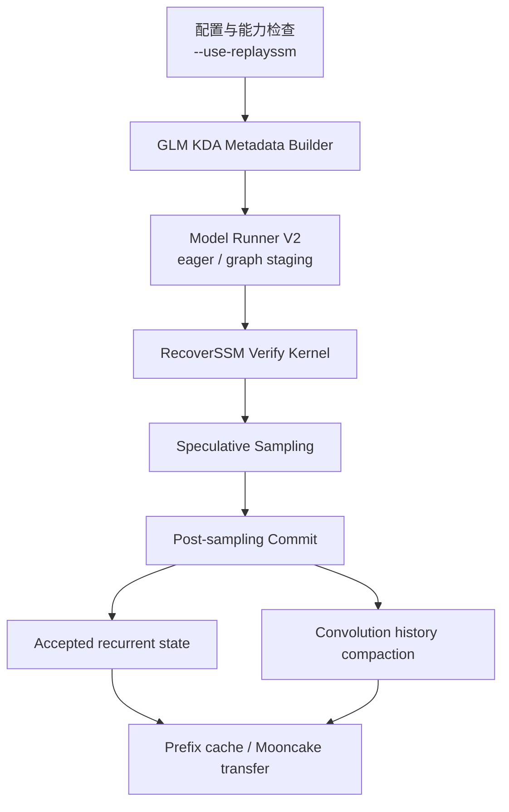

# GLM5.3-Flash RecoverSSM 实现方案

## 1. 文档目的

本文基于以下三个 PR 整理 GLM5.3-Flash RecoverSSM 的实现方案：

- [vllm-project/vllm-ascend#19133](https://github.com/vllm-project/vllm-ascend/pull/19133)
- [vllm-project/vllm#51855](https://github.com/vllm-project/vllm/pull/51855)
- [vllm-project/vllm#61566](https://github.com/vllm-project/vllm/pull/61566)

目标是明确 RecoverSSM 的算法、运行时生命周期、Ascend 后端适配方式，以及与 vLLM 上游实现的复用边界。

> 说明：#51855 已合入；#61566 和 #19133 在调研时仍处于 PR 状态。因此实现时需要以最终合入的 upstream 接口为准，并保留必要的兼容处理。

## 2. 背景与问题

GLM5.3-Flash 使用 KDA 结构进行 speculative decoding。普通实现会为每个 speculative position 保存一份完整 recurrent state。draft 长度为 `K` 时，每个 request 的 state 占用大致为 `2 + K` 个 state block，导致：

- state pool 容量下降；
- 并发 request 数受限；
- verify 阶段产生较多 state 写入；
- rejected token 对应的中间 state 需要额外存储和回收。

RecoverSSM 的核心思路是：

```text
一个 recurrent checkpoint
+ 每个 draft token 的轻量恢复记录
+ sampling 后按 accepted length 直接重建 state
```

在 #61566 的 GLM 方案中，KDA state 从每个 group 的 `2 + K` 个 state block，变为一个 checkpoint 加 correction/key/gate 记录；`K=4` 时，state-pool 占用约降低 2.8 倍。

## 3. 设计目标

### 3.1 功能目标

1. 支持 GLM5.3-Flash 的 MTP/DFlash speculative decoding。
2. 通过 `--use-replayssm` 开启 RecoverSSM。
3. verify 阶段只读取 checkpoint，并记录恢复所需的轻量数据。
4. sampling 后只重建 accepted position 的 recurrent state。
5. 同步压缩 convolution history。
6. 支持 Model Runner V2 的 eager 和 NPU graph 执行。
7. 支持 Ascend A3/A5 的专用 Triton kernel。
8. 支持 Mooncake prefill/decode 分离场景下的 checkpoint/cache transfer。

### 3.2 非目标

- 不改动普通 GLM prefill 和非 speculative decode 路径。
- 不在 vLLM 上游引入 Ascend 硬件细节。
- 不承诺 RecoverSSM 与普通 MTP 路径逐 token 等价。
- 不把 transient recovery records 写入 prefix cache。

## 4. 总体架构



各层职责如下：

| 层次 | 主要职责 |
|---|---|
| 配置层 | 解析 `--use-replayssm`，检查模型、spec decode、cache 和并行限制 |
| Metadata 层 | 分配 checkpoint、recovery records、state row 和 graph buffer |
| Verify 层 | 读取 checkpoint，计算正常 KDA 输出，记录 `u/k/g` |
| Sampling 层 | 完成 draft token 接受/拒绝判断，得到 accepted length |
| Commit 层 | 根据 accepted length 重建 recurrent state |
| Compact 层 | 将 convolution history 压缩到 accepted position 和 cache boundary |
| Runner 层 | 管理 Model Runner V2 生命周期、图捕获和设备 staging |
| Transfer 层 | 处理 Mooncake PD 场景下的 checkpoint/page 传输 |
| Kernel 层 | 提供 Ascend A3/A5 的 verify、commit、compact 实现 |

## 5. RecoverSSM 算法设计

### 5.1 KDA recurrence

KDA recurrent state 的更新形式为：

```text
S_t = S_(t-1) * exp(g_t) + u_t ⊗ k_t
```

其中：

- `S_t`：第 `t` 个 token 后的 recurrent state；
- `g_t`：gate；
- `k_t`：key；
- `u_t`：由 verify 阶段计算出的 correction；
- `⊗`：outer product。

### 5.2 Verify 阶段

Verify 阶段不修改 checkpoint `S0`，而是：

1. 从 page 中读取原始 checkpoint；
2. 正常计算 speculative 输出；
3. 对每个 draft token 保存：
   - `u_t`：FP32；
   - `k_t`：activation dtype；
   - `g_t`：activation dtype。

`u_t` 使用 FP32 是为了降低后续 state reconstruction 的数值误差；key 和 gate 继续使用 activation dtype，以控制额外记录空间。

### 5.3 Commit 阶段

sampling 得到 accepted length `p` 后，直接重建 accepted state：

```text
S_p = S_0 * exp(sum(g_1 ... g_p))
      + Σ_j u_j ⊗ (k_j * exp(sum(g_(j+1) ... g_p)))
```

Commit kernel 采用反向累积：

- 原始 checkpoint 只加载一次；
- 从 accepted token 反向处理 gate/key/correction；
- 不写入每个 speculative position 的中间 state；
- loop bound 使用真实 accepted length，而不是完整 speculative window。

这样可以避免为 rejected token 物化完整 recurrent state。

### 5.4 Convolution history compaction

commit 同步处理 convolution history：

- 将 convolution history 压缩到 accepted position；
- 如果 accepted range 跨过 prefix-cache boundary，则同时恢复 boundary state；
- checkpoint 和 convolution state 作为 cache boundary state 保留；
- correction/key/gate records 只用于本轮恢复，不进入 prefix cache。

## 6. Cache 与内存布局

每个 KDA page 的逻辑布局如下：

```text
(
  convolution state,
  KDA checkpoint,
  FP32 correction records,
  key/gate records
)
```

### 6.1 State 分配

普通路径：

```text
每个 speculative position 一份完整 recurrent state
```

RecoverSSM 路径：

```text
每个 KDA group：
  一个 checkpoint
  + K+1 组 correction/key/gate records
```

其中 `K+1` 需要覆盖 target token 或最终 commit 所需的边界位置。

### 6.2 Prefix cache

prefix cache 只保存稳定的边界状态：

- convolution state；
- KDA checkpoint。

transient recovery records 不参与 prefix-cache state copy，避免把本轮 speculative 中间数据错误地持久化。

### 6.3 Mooncake PD transfer

Mooncake 适配需要根据 producer/consumer 两端的 scratch-block 数量规划 checkpoint/page transfer：

1. producer 根据 RecoverSSM 的 single-checkpoint layout 计算导出页；
2. consumer 根据自身 MambaSpec scratch-block 数量恢复 view；
3. request-level Mooncake pull connector 负责异步接收；
4. 对异步接收的外部 cache page 遵守 upstream external-block zeroing contract；
5. 当前方案要求 equal-TP 的 PD 范围。

## 7. 与上游 PR 的复用关系

### 7.1 复用 vLLM #51855

#51855 是 RecoverSSM 的基础实现，提供：

- `--use-replayssm` 语义；
- KDA RecoverSSM flag；
- checkpoint + transient records 的 state layout；
- verify 记录协议；
- post-sampling commit 生命周期；
- accepted-position reconstruction；
- convolution boundary reconstruction；
- Model Runner V2 接入方式。

Ascend 侧应复用这些接口和生命周期，不重新定义一套 GLM 专属的上层 RecoverSSM 流程。

### 7.2 复用 vLLM #61566

#61566 将 GLM5.3-Flash 接入 Kimi-K3 已有的 RecoverSSM 机制，核心复用包括：

- Kimi-K3 的 verify/commit 语义；
- Kimi-K3 的 metadata builder；
- 共享的 `--use-replayssm` 开关；
- GLM 的 state layout 和 dispatch 适配；
- 不增加新的 RecoverSSM 算法 kernel。

这说明 GLM 的上层接入应保持模型适配薄层化，RecoverSSM 的算法和生命周期仍由共享实现负责。

### 7.3 Ascend #19133 自己实现的部分

#19133 的新增内容主要是平台后端适配：

- Ascend Triton verify kernel；
- Ascend Triton commit kernel；
- convolution compaction kernel；
- A3/A5 tile、stride、mask 和 UB 优化；
- NPU graph capture/staging；
- Ascend descriptor 和 state layout；
- Mooncake PD transfer；
- GLM target/draft 配置读取；
- Ascend-specific validation 和性能调优。

复用边界可以表示为：

```text
vLLM #51855
  定义 RecoverSSM 基础契约和生命周期
        ↓
vLLM #61566
  定义 GLM 使用共享 RecoverSSM 的方式
        ↓
vllm-ascend #19133
  实现 Ascend kernel、graph、cache 和 PD transfer
```

## 8. 推荐代码模块边界

```text
vLLM upstream
├── RecoverSSM enablement and validation
├── KDA state/recovery contract
├── metadata builder interface
├── post-sampling commit lifecycle
├── request partitioning
└── model-independent cache semantics

vllm-ascend
├── GLM Ascend model adapter
├── Ascend metadata descriptors
├── Ascend Triton verify kernel
├── Ascend Triton commit kernel
├── convolution compaction kernel
├── Model Runner V2 graph staging
├── Mooncake transfer integration
└── A3/A5 hardware tuning
```

原则是：

- 算法契约放在 vLLM 上游；
- 模型差异通过 metadata builder、state layout 和 dispatch 适配；
- Ascend 硬件细节保留在 vllm-ascend；
- 不把 Ascend kernel 参数反向暴露为上游模型逻辑；
- 普通路径和 RecoverSSM 路径保持清晰的 feature switch。

## 9. 配置与运行时限制

Ascend 版本建议在 worker 启动前完成以下校验：

- 必须启用 speculative decoding；
- 只支持 GLM5.3-Flash 目标模型及对应 draft 模型；
- 只允许 Model Runner V2；
- Mamba cache mode 必须为 `none`；
- prefix caching 和 stochastic rounding 必须关闭；
- `PP/PCP/DCP` 必须为 1；
- PD connector 仅支持 `MooncakeConnectorV2` 和 `MooncakePullConnector`；
- 未开启 RecoverSSM 时继续走原生 AscendC 路径；
- 不带 speculative decoding 单独使用 `--use-replayssm` 时直接报错。

配置开关应保持 default-off，确保现有用户和其他模型路径行为不变。

## 10. 实现步骤

### 阶段一：上游接口对齐

1. 确认 vLLM #51855 中最终的 RecoverSSM contract。
2. 跟进 #61566 的 GLM metadata、state layout 和 dispatch 变更。
3. 删除 Ascend 侧对旧接口的临时兼容代码，或集中封装在 adapter 中。
4. 确保 vLLM 源码不需要引入 Ascend 专属判断。

### 阶段二：GLM metadata 与 state layout

1. 增加 GLM RecoverSSM metadata builder。
2. 为每个 group 分配一个 checkpoint。
3. 分配 correction/key/gate records。
4. 生成 request partition、state row 和 page descriptor。
5. 处理 GLM `A_log` flatten 和 composite Transformers config。
6. 创建 post-sampling committer。

### 阶段三：Ascend kernel

1. 实现 verify kernel。
2. 实现 accepted-state commit kernel。
3. 实现 convolution history compaction。
4. 适配 A3/A5 的 tile、stride、mask 和 UB 限制。
5. 统一普通 layout、grouped-head layout 和 ragged layout 的参数处理。
6. 保留独立的 kernel reference 实现用于数值校验。

### 阶段四：Model Runner V2

1. 在 eager 路径接入 RecoverSSM metadata。
2. 在 graph capture 阶段创建持久化 staging buffer。
3. 将 padding offset 保持在 device stream 上处理。
4. 对 oversized batch 做容量检查，超限时回退 eager metadata。
5. 在 sampling 完成后触发 commit 和 compaction。

### 阶段五：Mooncake

1. 根据 producer/consumer scratch-block 数量生成 transfer plan。
2. 支持 single-checkpoint/four-view layout。
3. 支持 request-level Mooncake pull connector。
4. 对异步外部 page 处理 zeroing flag。
5. 验证 equal-TP PD 场景的 checkpoint 一致性。

## 11. 验证方案

### 11.1 Kernel 单元测试

覆盖：

- H32/H64；
- K=V=128；
- BF16/FP16 activation；
- FP32/BF16 state；
- accepted length 为 0、部分接受、全部接受；
- Q1/Q2/Q4/Q6/Q8 路径；
- head padding；
- non-contiguous metadata；
- untouched padding；
- ragged tile；
- grouped multi-layer paged layout。

### 11.2 数值一致性

至少比较：

1. RecoverSSM verify 输出与 native `fused_recurrent_kda` 输出；
2. RecoverSSM committed state 与 native per-slot state；
3. convolution compact state 与 reference implementation；
4. prefix boundary state；
5. Mooncake transfer 前后 state。

对 FP32、FP16、BF16 分别设置误差阈值，并检查 untouched region 必须 bitwise identical。

### 11.3 集成测试

覆盖：

- GLM5.3-Flash + MTP；
- GLM5.3-Flash + DFlash；
- eager runner；
- NPU graph runner；
- prefix caching off；
- Mooncake prefill/decode separation；
- 变长 request；
- 多 request remapping；
- accepted length 跨 prefix boundary；
- oversized batch graph staging 回退。

### 11.4 性能测试

比较 RecoverSSM on/off：

- state pool 占用；
- GPU/NPU KV cache capacity；
- max concurrency；
- verify latency；
- commit latency；
- convolution compaction latency；
- TPOT；
- generation throughput；
- acceptance length。

## 12. 风险与注意事项

1. RecoverSSM 是实验特性，开启后不保证与普通 MTP 逐 token 等价。
2. checkpoint 数量减少不代表总 KV cache 预留内存按同一比例下降。
3. #61566 尚未合入时，Ascend 侧需要兼容 upstream 新旧 cache contract。
4. #19133 当前存在 merge conflict，最终接口和调用位置可能变化。
5. A3 和 A5 的 UB、tile 和 stride 约束不同，不能简单共用完全静态的 kernel 参数。
6. graph 路径必须检查 token、request、state-row 容量，避免 oversized batch 写入持久化 buffer。
7. Mooncake 异步接收路径必须正确处理 external-block zeroing，否则可能引入 cache page 内容污染。
8. transient recovery records 不能进入 prefix cache，否则会把本轮 draft 状态错误复用于后续请求。

## 13. 结论

GLM5.3-Flash RecoverSSM 应采用“上游定义恢复契约、GLM 做模型适配、Ascend 实现硬件后端”的分层方案：

- vLLM #51855 提供 RecoverSSM 基础生命周期和数据协议；
- vLLM #61566 提供 GLM 复用 Kimi-K3 RecoverSSM 的接入方式；
- vllm-ascend #19133 提供 Ascend Triton kernel、Model Runner V2 graph staging、cache layout 和 Mooncake PD transfer。

实现时应优先保持上游接口兼容，把 Ascend 差异限制在 metadata descriptor、kernel、graph 和 transfer adapter 中，从而避免 GLM、Kimi-K3 以及未来 KDA 模型形成多套互不兼容的 RecoverSSM 实现。
