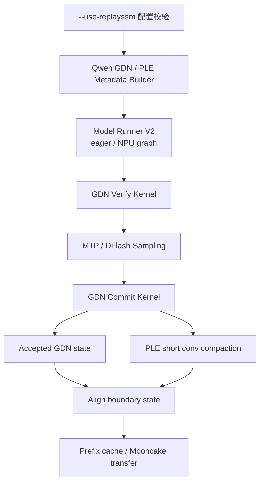

# Qwen GDN RecoverSSM 实现设计方案

## 1. 文档目的

本文面向昇腾硬件，设计 Qwen GDN RecoverSSM 的迁移与实现方案。参考资料：

- [vllm-project/vllm#58863](https://github.com/vllm-project/vllm/pull/58863)：Qwen4Exp GDN 和 PLE short convolution 的 RecoverSSM 基础实现
- [vllm-project/vllm#61309](https://github.com/vllm-project/vllm/pull/61309)：Qwen3.5/Qwen3-Next GDN 的模型接入
- [vllm-project/vllm-ascend#19133](https://github.com/vllm-project/vllm-ascend/pull/19133)：GLM5.3-Flash KDA RecoverSSM 的昇腾实现参考
- [vllm-project/vllm#51855](https://github.com/vllm-project/vllm/pull/51855)：Kimi-K3 RecoverSSM 基础协议

设计目标是复用上游 RecoverSSM 生命周期和公共 Mamba 抽象，在昇腾侧实现 GDN verify、commit、PLE short convolution compact、Model Runner V2 graph staging 和 Mooncake cache transfer。

> 状态说明：#51855 已合入；#58863 及 #61309 在调研时仍处于 open/draft 状态。实现应锁定明确的 upstream commit，并将兼容逻辑集中在 Ascend adapter 中。

## 2. 背景与问题

Gated DeltaNet（GDN）在 speculative decoding 中，如果为每个 draft position 保存完整 recurrent state，会产生以下问题：

- 每个 draft token 需要额外的 Mamba state block；
- verify 阶段需要频繁写回完整 state；
- rejected token 对应的 state 占用 cache 容量；
- 并发数和可服务 token 数下降。

上游 #58863 将 GDN 改造为 RecoverSSM 路径：verify 只读取一个 checkpoint，并记录每个 draft token 的轻量 replay record；sampling 得到 accepted length 后，只 replay accepted tokens 并一次性提交 state，同时压缩 PLE short convolution history。[#58863](https://github.com/vllm-project/vllm/pull/58863)

Qwen3.5/Qwen3-Next 使用相同的 GDN layer，#61309 主要增加模型类、MTP drafter 和配置接入。[#61309](https://github.com/vllm-project/vllm/pull/61309)

## 3. 设计目标

### 3.1 功能目标

1. 支持 Qwen3.5、Qwen3-Next 以及对应 MTP/DFlash speculative decoding。
2. 通过 `--use-replayssm` 开启 RecoverSSM。
3. verify 阶段只读取 GDN checkpoint，并记录 replay records。
4. sampling 后只恢复 accepted token 对应的 GDN state。
5. 同步压缩 PLE dilated short convolution history。
6. 支持 Model Runner V2 的 eager 和 NPU graph 执行。
7. 支持昇腾 A3/A5 的 GDN verify、commit 和 compact kernel。
8. 支持 align mode、prefix caching 和 Mooncake PD transfer。

### 3.2 非目标

- 不改变普通 GDN prefill 和非 speculative decode 路径。
- 不把 KDA 的 `u/k/g` 数据布局直接套用到 GDN。
- 不在 vLLM 上游引入昇腾硬件细节。
- 不把 transient replay records 写入 prefix cache。
- 不保证 RecoverSSM 与普通 speculative decoding 逐 token 等价。

## 4. GDN 与 GLM KDA 的差异

### 4.1 共同的 RecoverSSM 生命周期

```text
读取只读 checkpoint
    ↓
verify 计算 speculative 输出并记录 replay data
    ↓
sampling 得到 accepted length
    ↓
只 replay accepted tokens
    ↓
一次性提交 recurrent state
    ↓
压缩短卷积 history
```

### 4.2 Replay record 不同

GLM KDA 记录：

```text
correction u
key k
raw gate g
```

GDN 记录：

```text
correction V
normalized key K
gate
```

上游 GDN 方案将 `V/K/gate` 作为 FP32 replay records。[#58863](https://github.com/vllm-project/vllm/pull/58863)

因此，昇腾侧可以复用 RecoverSSM 的 commit plan、request mapping 和生命周期，但必须单独实现 GDN verify kernel 和 GDN state descriptor。

### 4.3 GDN 额外包含 PLE short convolution

Qwen GDN 的 RecoverSSM 同时管理两类状态：

- GDN recurrent state；
- PLE dilated short convolution history。

commit 时必须同时完成：

- GDN accepted state reconstruction；
- PLE accepted window compaction；
- align boundary state reconstruction。

### 4.4 GDN 目标是 align + prefix cache

上游 GDN 已验证以下场景：

```text
--mamba-cache-mode align
--enable-prefix-caching
--mamba-backend triton
```

因此不能简单照搬 GLM Ascend 方案中 `mamba_cache_mode=none` 和关闭 prefix caching 的限制。GDN Ascend 方案应将 align/prefix cache 作为主要目标；如果硬件后端尚未稳定，可先分阶段实现。

## 5. 总体架构



### 5.1 分层职责

| 层次 | 主要职责 |
|---|---|
| 配置层 | 校验 `--use-replayssm`、模型、spec decode、cache mode 和并行限制 |
| GDN metadata | 分配 checkpoint、replay records、state row 和 boundary slot |
| PLE metadata | 描述 dilated short conv 的窗口、stride 和 boundary mapping |
| Verify 层 | 从 strided q/k/v view 计算输出并写 replay records |
| Sampling 层 | 计算 token 接受/拒绝和 accepted length |
| Commit 层 | 根据 accepted length 恢复 GDN recurrent state |
| Compact 层 | 压缩 PLE short convolution history |
| Runner 层 | 管理 eager、NPU graph、padding 和 staging buffer |
| Transfer 层 | 管理 Mooncake PD page/checkpoint 传输 |
| Kernel 层 | 提供昇腾 A3/A5 的 verify、commit 和 compact 实现 |

## 6. 上游设计复用

### 6.1 复用 #51855 的基础协议

复用内容包括：

- `--use-replayssm` 语义；
- RecoverSSM enablement 和 validation；
- checkpoint + transient records 的布局思想；
- post-sampling commit 生命周期；
- accepted-position reconstruction；
- request mapping；
- Model Runner V2 接入方式。

### 6.2 复用 #58863 的 GDN/PLE 实现抽象

#58863 已将公共逻辑从 Kimi-K3 私有目录抽到 Mamba 公共目录：

```text
model_executor/layers/mamba/ops/recoverssm.py
    通用 commit / compact kernel

model_executor/layers/mamba/recoverssm_utils.py
    通用 request mapping / commit plan

model_executor/layers/mamba/gdn/recoverssm_gdn.py
    GDN 专用 verify / commit

gdn_recoverssm.py
    GDN metadata builder

ple_recoverssm.py
    PLE metadata builder
```

昇腾侧应以这些公共抽象为接口，避免重新实现一套 Kimi-K3 或 GLM 专属 RecoverSSM manager。

### 6.3 复用 #61309 的模型接入

#61309 主要将同一 GDN layer 接入：

- Qwen3.5 dense；
- Qwen3.5 MoE；
- Qwen3-Next；
- CausalLM；
- ConditionalGeneration；
- MTP drafter。

昇腾侧只需要为这些模型提供后端能力声明、配置解析和 Ascend layer dispatch，不应复制 GDN RecoverSSM 算法。

## 7. Ascend 目标代码边界

```text
vLLM upstream
├── generic RecoverSSM contract
├── generic Mamba commit / compact helpers
├── GDN metadata interface
├── PLE metadata interface
├── request mapping
├── model capability declaration
└── config validation

vllm-ascend
├── Qwen GDN Ascend adapter
├── Qwen PLE Ascend adapter
├── Ascend GDN verify kernel
├── Ascend GDN commit kernel
├── Ascend PLE compact kernel
├── A3/A5 graph staging
├── Ascend state descriptors
└── Mooncake cache transfer adapter
```

核心边界是：

```text
共享：生命周期、metadata 抽象、request mapping、commit plan、graph/transfer 框架
GDN 专属：V/K/gate record、GDN recurrence、GDN verify、PLE short conv
Ascend 专属：Triton kernel、tile/stride/UB、NPU graph、Mooncake page transfer
```

## 8. Cache 与内存布局

建议每个 GDN page 使用如下逻辑布局：

```text
(
    PLE convolution state,
    GDN recurrent checkpoint,
    FP32 V records,
    FP32 normalized-K records,
    FP32 gate records
)
```

### 8.1 State 分配

普通路径：

```text
每个 speculative position 一份完整 GDN state
```

RecoverSSM 路径：

```text
每个 GDN group：
  一个 recurrent checkpoint
  + K+1 组 V/K/gate replay records
```

`K+1` 应覆盖 draft token 以及最终 target/boundary 所需的记录。

### 8.2 Page size 计算

由于 GDN 的 `V/K/gate` 均为 FP32，replay record 可能明显大于 KDA 的 activation-dtype key/gate 记录。metadata builder 应显式计算：

```text
page_bytes =
    checkpoint_bytes
  + ple_state_bytes
  + replay_record_bytes
  + alignment_padding
```

上游观察到 replay record 会让 unified page 增大约 6%，并可能影响 `max_num_seqs`、hybrid attention block 对齐和 prefix reuse。[#58863](https://github.com/vllm-project/vllm/pull/58863)

### 8.3 Prefix cache

prefix cache 只保存稳定的边界状态：

- GDN recurrent checkpoint；
- PLE convolution boundary state。

transient `V/K/gate` records 不进入 prefix cache。

## 9. GDN Verify 设计

### 9.1 输入输出

GDN verify kernel 读取：

- GDN checkpoint；
- convolution output 中的 strided q/k/v view；
- request mapping；
- window length；
- gate/normalization 参数。

输出：

- 正常 GDN layer output；
- FP32 `V` replay records；
- FP32 normalized `K` replay records；
- FP32 gate replay records。

上游设计强调 verify 应读取 strided q/k/v view，并直接写入 layer output。[#58863](https://github.com/vllm-project/vllm/pull/58863)

### 9.2 两条 Ascend kernel 路径

#### 连续布局快速路径

适用于：

- uniform batch；
- q/k/v contiguous；
- window length 相同；
- state row contiguous。

可以使用固定 tile、静态循环和较少的 runtime stride 参数。

#### 非连续布局通用路径

适用于：

- mixed prefill/decode；
- ragged window；
- request row remapping；
- strided q/k/v；
- graph padding；
- 非连续 state row。

该路径优先保证通用性和正确性，再进行 tile/stride 优化。

### 9.3 Graph padding

graph padding row 使用：

```text
state slot = null
window length = 0
```

verify 必须保证 padding row：

- 不写 replay record；
- 不修改 GDN state；
- 不污染 layer output 的有效 request 区域。

## 10. GDN Commit 设计

建议复用 upstream 的 generic commit plan：

```text
generic commit plan
    ├── accepted length
    ├── request mapping
    ├── source state slot
    ├── final state slot
    └── boundary state slot
```

Ascend 侧替换底层 kernel 实现，不重新定义上层 plan。

### 10.1 Accepted state

commit 只 replay accepted token：

```text
S_accept = Replay(
    S_checkpoint,
    V[0:p],
    K[0:p],
    gate[0:p]
)
```

其中 `p` 是实际 accepted length，而不是完整 speculative window。

### 10.2 Align boundary

如果 accepted range 跨越 block boundary，同时生成：

```text
final accepted state
boundary state
```

如果 accepted token 恰好结束在 boundary，boundary state 应写入最后一个 token 所在 block：

```text
boundary_block = (n - 1) // block_size
```

不能写入下一个可能未分配的 block。[#58863](https://github.com/vllm-project/vllm/pull/58863)

### 10.3 防止 final/boundary 覆盖

建议采用两阶段 fold：

```text
第一阶段：完成 final state fold
第二阶段：完成 boundary state fold
```

如果 boundary slot 与 final slot 相同，则跳过重复写入。这样可以避免一个程序覆盖另一个程序仍在读取的 source tile。

## 11. PLE Short Convolution 设计

PLE 采用独立的 state/metadata 描述，但复用通用 commit plan：

```text
PLE checkpoint/history
    ↓
accepted window mapping
    ↓
short-conv compact
    ↓
accepted position state
    ↓
optional align boundary state
```

需要实现：

1. PLE history page layout；
2. accepted window 到 source/destination slot 的映射；
3. dilation stride；
4. exact-boundary 和 crossing-boundary；
5. 非连续 request row；
6. final/boundary 两阶段写入。

如果 PLE short conv 与通用 Mamba short conv 的布局一致，应复用公共 compact helper；如果 dilation/stride 不同，只增加 PLE descriptor 和 kernel 参数，不复制整个 compact framework。

## 12. Model Runner V2 与图执行

上游 GDN metadata builder 声明 `AttentionCGSupport.UNIFORM_BATCH`，uniform speculative batch 可以捕获 FULL graph，mixed batch 使用 PIECEWISE。[#58863](https://github.com/vllm-project/vllm/pull/58863)

Ascend 侧建议：

1. eager 路径首先接通；
2. uniform batch 使用 FULL graph；
3. mixed/ragged batch 使用 PIECEWISE；
4. padding row 使用 null state slot；
5. graph capture 前检查 token/request/state-row capacity；
6. oversized batch 回退到 eager metadata 或 PIECEWISE；
7. profiling teardown 释放 replay step 和 commit context，避免长期持有 cache；
8. padding offset 优先在 device stream 上计算，避免阻塞 host-to-device copy。

## 13. Mooncake PD Transfer

Mooncake 适配应围绕 GDN/PLE 的稳定边界状态进行，而不是传输 transient replay records。

### 13.1 Producer

producer 侧导出：

- GDN checkpoint；
- PLE boundary state；
- page descriptor；
- state view/stride 信息。

### 13.2 Consumer

consumer 侧恢复：

- GDN state row；
- PLE state row；
- prefix-cache boundary mapping；
- graph metadata view。

### 13.3 约束

- 初期建议先支持 equal-TP PD；
- 遵守 external-block zeroing contract；
- 校验 GDN 与 PLE state 的 page 对齐；
- 对异步接收 page 避免重复 zeroing；
- 对 replay record 较大的 page 重新计算 transfer size。

## 14. 配置方案

### 14.1 第一阶段

如果 Ascend 的 align/prefix cache 尚未稳定，可先支持：

```text
--use-replayssm
--mamba-backend triton
--mamba-cache-mode none
prefix caching = off
PP = 1
Model Runner V2
```

第一阶段目标是验证 GDN verify、accepted commit、PLE compact 和 graph/eager 路径。

### 14.2 第二阶段

增加：

```text
--mamba-cache-mode align
--enable-prefix-caching
Mooncake PD transfer
```

并支持：

- exact boundary；
- crossing boundary；
- prefix-cache hit；
- hybrid attention block 对齐；
- GDN/PLE boundary state transfer。

### 14.3 运行时校验

建议在 worker 启动前校验：

- 必须启用 speculative decoding；
- 模型必须是 Qwen GDN 支持的架构；
- 必须使用 Model Runner V2；
- 必须使用 Triton Mamba backend；
- 初期 `PP=1`；
- `--use-replayssm` 无 speculative decoding 时直接拒绝；
- 不开启 RecoverSSM 时继续走原生路径。

## 15. 实现阶段

### 阶段一：同步上游接口

1. 以 #58863 为 GDN 基线。
2. 同步 #61309 的 Qwen3.5/Qwen3-Next model wiring。
3. 确认公共 `recoverssm.py` 和 `recoverssm_utils.py` 的最终接口。
4. 统一 Ascend 分支的 upstream revision。
5. 将兼容逻辑集中在 adapter 中。

### 阶段二：Ascend GDN verify

1. 实现连续布局路径。
2. 实现 strided q/k/v 路径。
3. 支持 uniform/ragged window。
4. 支持 request row remapping。
5. 支持 graph padding row。
6. 输出 FP32 `V/K/gate` replay record。
7. 与 native fused GDN kernel 做数值比较。

### 阶段三：Ascend commit 和 PLE compact

1. 接入 generic commit plan。
2. 实现 GDN accepted state commit。
3. 实现 PLE accepted-window compact。
4. 实现 align boundary state。
5. 实现 final/boundary 两阶段 fold。
6. 增加 A3/A5 tile、stride 和 UB 优化。

### 阶段四：Model Runner V2

1. 接入 eager。
2. 接入 NPU graph。
3. 支持 FULL/PIECEWISE graph。
4. 处理 padding row 和 oversized batch。
5. 释放 profiling replay context。
6. 将 graph padding offset 保持在 device stream 上。

### 阶段五：Mooncake

1. 扩展 producer/consumer transfer plan。
2. 加入 GDN checkpoint 和 PLE state。
3. 处理更大的 replay-record page。
4. 支持 equal-TP PD。
5. 验证外部 page zeroing。
6. 验证 prefix cache 命中后的 GDN/PLE state 一致性。

## 16. 验证方案

### 16.1 GDN kernel

覆盖：

- accepted length 1 到完整 window；
- exact boundary；
- crossing boundary；
- 非连续 request row；
- uniform/ragged window；
- strided q/k/v；
- `out=` 直接写回；
- BF16 recurrent state；
- extreme gate；
- 多 seed；
- malformed input；
- graph padding row。

### 16.2 PLE kernel

覆盖：

- accepted length 1；
- accepted length 2；
- full window；
- dilation stride；
- exact boundary；
- crossing boundary；
- non-contiguous request row；
- 与 token-by-token short-conv decode 对比。

### 16.3 集成测试

覆盖：

- Qwen3.5 dense；
- Qwen3.5 MoE；
- Qwen3-Next；
- CausalLM；
- ConditionalGeneration；
- MTP；
- DFlash；
- eager；
- NPU graph；
- align cache；
- prefix cache；
- Mooncake PD；
- mixed prefill/decode；
- request remapping；
- oversized graph batch。

### 16.4 正确性指标

至少比较：

```text
RecoverSSM verify output
    vs native fused GDN output

RecoverSSM committed GDN state
    vs native per-token state

PLE compact state
    vs token-by-token short-conv decode

prefix cache state
    vs non-cache recomputation

Mooncake transfer state
    vs local state
```

BF16 state 允许一次舍入，但误差不应超过 native path 相对 FP32 reference 的误差范围。

### 16.5 性能指标

重点测量：

- state pool 使用量；
- page size；
- max concurrent sequences；
- verify latency；
- GDN commit latency；
- PLE compact latency；
- graph capture 成功率；
- prefix-cache hit rate；
- KV token capacity；
- TPOT；
- output throughput；
- 不同 draft length 和 concurrency 下的收益。

上游 Qwen3.5 实测显示，收益主要来自消除 per-draft-position state write-back，随 draft length 和 batch size 增加而提升；在 K=5、并发 32 的测试中报告约 8.6% throughput 提升。[#61309](https://github.com/vllm-project/vllm/pull/61309)

## 17. 主要风险

1. **不能直接套用 GLM KDA record layout。** GDN 使用 `V/K/gate`，并且上游定义为 FP32 record。
2. **不能遗漏 PLE short conv。** 只恢复 GDN state 会导致后续 token 状态错误。
3. **align boundary 容易越界或覆盖。** exact-boundary 应写入最后 token 所在 block；final fold 和 boundary fold 要分阶段执行。
4. **replay record 会增大 page。** 可能降低 `max_num_seqs`，改变 hybrid attention block 对齐并影响 prefix reuse。
5. **Ascend 图执行不能照搬 CUDA graph。** 必须分别验证 FULL、PIECEWISE、padding row 和 oversized batch 回退。
6. **GDN commit 可复用，verify 不应盲目复用。** 共享 commit plan 和 compact helper，单独实现 GDN verify。
7. **上游 PR 仍可能变化。** #58863 和 #61309 尚未最终合入时，应锁定 upstream revision，并把兼容层集中在 adapter 中。

## 18. 结论

Qwen GDN Ascend RecoverSSM 应采用以下迁移路径：

```text
同步 #58863 的公共 RecoverSSM/Mamba 抽象
        ↓
接入 #61309 的 Qwen3.5/Qwen3-Next model wiring
        ↓
复用 GLM Ascend 的 MRV2、graph staging 和 Mooncake 框架
        ↓
重新实现 Ascend GDN verify
        ↓
复用/改造 Ascend commit plan 和 compact kernel
        ↓
补齐 PLE、align、prefix cache 和 PD transfer
```

最终架构原则：

```text
共享：RecoverSSM 生命周期、request mapping、commit plan、graph/transfer 框架
GDN 专属：V/K/gate replay record、GDN recurrence、GDN verify、PLE short conv
Ascend 专属：Triton kernel、tile/stride/UB、NPU graph staging、Mooncake transfer
```

这样既能最大程度复用 GLM5.3-Flash RecoverSSM 的昇腾工程框架，又能避免将 KDA 的状态布局和 kernel 假设错误地带入 Qwen GDN。
